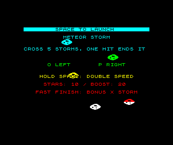

# Windows Spectrum startup repair

The repaired native Windows build passes startup and the complete Meteor Storm
package-to-boot journey. The original inline runtime reproduces the stack
overflow in the same job. Both executables retain the original 1 MiB stack
reserve.

[PR #1793](https://github.com/emu198x/emu198x/pull/1793) fixes
[issue #1792](https://github.com/emu198x/emu198x/issues/1792).
[Native run 38925425661](https://github.com/emu198x/emu198x/actions/runs/38925425661)
passes on Windows Server 2022 AMD64. Artifact ID: `12057172101`.

## Before and after

The family enum stored every concrete runtime inline. Its largest Timex
payload made even the 48K path carry a 74,568-byte value, although the concrete
48K runtime occupies 840 bytes. Boot return values and sessions carry that
family value through nested startup calls. Boxing the concrete payloads keeps
the family value at 16 bytes, with static dispatch and unchanged machine state.
The size observations come from the local optimised ARM64 build; the native
Windows execution below establishes the startup result on Windows.

| Native check | Result |
| --- | --- |
| Original `family_runtime.rs` from `9a22ce6c5` | The zero-frame query exits `0xC00000FD`; stderr reports main-thread stack overflow. |
| Repaired distribution build | The same query exits zero and reports CPU state at reset, with time zero. |
| Actual PE stack reserve | 1,048,576 bytes in both binaries. |
| Script and MCP process regressions | Pass in the candidate build. |
| Full positive journey | Loads CODE through the genuine ROM tape path; PC is `$80AF`, phase is zero, and title pixels match. |
| Real tape missing CODE | Emulator exits normally; the same verifier rejects it because the assembled entry bytes were not loaded. |
| Firmware and scratch cleanup | Pass. |

The before/after build changes the family-runtime implementation; the baseline
step restores the candidate source before rebuilding. The existing journey
harness is pinned at `3a82574eb0b9e844bcedf6dd4d118cf84b84d13b` and remains
unchanged. Only its copied Emu input pin selects the locally built candidate
ZIP. `candidate-input.json` records the source revision, harness identity and
exact candidate pin. Asm 0.0.67, Build 0.2.12, the genuine firmware identity,
sample revision and acceptance checks stay fixed.

The generated six-block tape has SHA-256
`31420966522468be267830cf1b0ce5fe31087b987dfe293d879512a67de4933d`, matching the
earlier failed audit's package. All packaging commands and both real emulator
runs exit zero. This verifies the source candidate in PR #1793; publication
awaits merge and release.

## Retention and local checks

`run-38925425661/` preserves the artifact bytes, run/job/step metadata and
artifact identity. `sha256.json` hashes the retained files. Original generated
output retains its original line endings. No genuine firmware, executables or
release archives are included. The screenshot and RAM observations are
generated by the game.

Local validation has 373 passing tests, zero failures and 63 existing ignored
fixture tests, plus clean scoped Clippy, rustfmt, Ruff, YAML and Vale checks.
`local-validation.json`, `tests.log` and `clippy.log` retain those results.
Regular Windows CI now runs the synthetic-ROM startup regression automatically.
